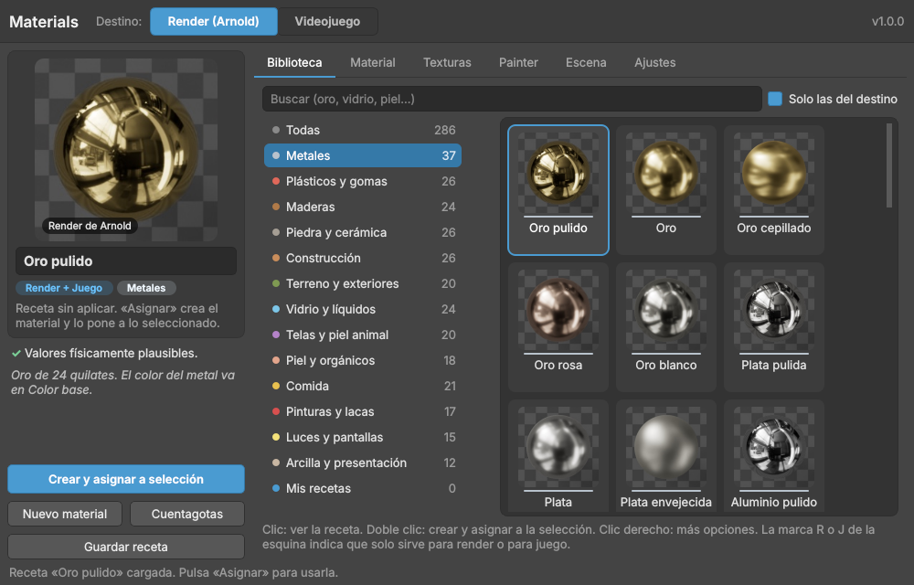

# Materials

Configurador rápido de materiales **OpenPBR** para Autodesk Maya (2026 y 2027, Mac y Windows), con ida y vuelta
a **Substance 3D Painter**. Pensado para el aula y para proyectos reales: elegir un material en segundos, ajustarlo
con ocho controles que se entienden, y mandar el objeto a Painter para recibir las texturas ya conectadas.



Hypershade lo puede todo y por eso abruma. Materials cubre el recorrido de casi cualquier proyecto y deja el
resto a Hypershade: los materiales que crea son nodos `openPBRSurface` normales, que se pueden seguir tocando a mano.

## Instalar

1. Descarga o clona esta carpeta y déjala donde vaya a quedarse (por ejemplo `Documentos/maya/Materials`).
2. Abre Maya y arrastra `instalar.py` desde el Finder o el Explorador hasta el visor.
3. Aparece el menú **Materials** en la barra de Maya. Se carga solo cada vez que abres Maya.
4. El instalador copia también el complemento de Painter. En Painter, actívalo una vez en
   **Python ▸ materials_painter**: aparece el panel *Materials*.

Maya 2027 puede preguntar si confías en el plug-in de una carpeta nueva: pulsa *Allow*.
Para desinstalar, borra `materials.mod` de la carpeta `modules` de tus preferencias de Maya y
`materials_painter.py` de `Documentos/Adobe/Adobe Substance 3D Painter/python/plugins` (las rutas salen en el
Script Editor al instalar).

## Render o videojuego

Arriba de la ventana se elige el destino, y la escena lo recuerda.

| | Render (Arnold) | Videojuego (Unreal, Unity, glTF) |
|---|---|---|
| Controles | Los ocho | Color, Rugosidad, Metal, Transparencia (alfa) y Emisión. Subsuperficie, Barniz y Pelusa se apagan: no viajan por FBX |
| Transparencia | Transmisión real con refracción | Alfa, como en los motores |
| Painter exporta | Mapas sueltos, normal OpenGL, altura en 16 bits | Unreal: ORM y normal DirectX · Unity: BaseMap y MaskMap · glTF: ORM y normal OpenGL |
| Comprobación | Valores físicos | Además: metal 0 o 1, texturas en potencias de dos, sin desplazamiento |

Cada receta indica para qué sirve (las marcadas **·R** solo para render y **·J** solo para juego).

## Qué hace

| | |
|---|---|
| **Biblioteca** | 286 recetas con valores reales en 13 familias: metales (con el reflejo medido de cada uno), plásticos y gomas, maderas, piedra y cerámica, construcción, terreno, vidrio y líquidos, telas, piel y orgánicos, comida, pinturas y lacas, luces y pantallas, y arcilla para presentar. Buscador sin tildes. Muchas llevan una nota que explica el porqué. |
| **Ocho controles** | Color, Rugosidad, Metal, Transparencia, Subsuperficie, Barniz, Pelusa y Emisión. Cada uno mueve los atributos de OpenPBR que tocan. «Más…» abre lo fino (IOR, anisotropía, colores propios, pared fina, película fina) y «Modo experto» abre el Attribute Editor. |
| **Asignar** | A objetos o caras seleccionados; doble clic en una receta la crea y la asigna. El cuentagotas edita el material de lo seleccionado; mientras editas, los cambios se ven en el visor y en el render interactivo. |
| **Comprobación física** | Avisos que enseñan: un no metal demasiado oscuro o claro, metal a medias sin textura, IOR raros, mapas de datos en sRGB, normales DirectX, texturas que no son potencia de dos… |
| **Texturas de cualquier sitio** | Elige una carpeta y reconoce los mapas por su nombre (Painter, Poly Haven, Quixel, Unreal, Unity…), con UDIM, espacio de color correcto, ORM y MaskMap por canales, suavidad invertida, normal OpenGL o DirectX y altura como relieve o desplazamiento. Si el nombre coincide con un material, se conecta solo. |
| **Painter** | «Enviar a Painter» exporta el objeto (un juego de texturas por material) y la receta. En Painter, el panel Materials abre el envío con una capa con tus valores de Maya. «Exportar a Maya» exporta con la plantilla del destino y Maya conecta o recarga las texturas sin tocar nada, cada vez. Si cambias UVs, «Actualizar malla» y Painter recarga la malla conservando las capas. |
| **Rutas que no se rompen** | Las texturas usan rutas relativas al proyecto. «Reparar rutas» encuentra imágenes movidas y «Copiar al proyecto» recoge las de fuera antes de entregar. |
| **Escena** | Lista de materiales con objetos, texturas y avisos; seleccionar sus objetos, poner prefijo `M_`, convertir Standard Surface, aiStandardSurface o Lambert a OpenPBR y borrar los que no se usan. |
| **Recetas propias y de clase** | «Guardar receta» las deja en *Mis recetas*. El profesor puede indicar una carpeta compartida con recetas (.json) que aparecen como *Recetas de clase*. |

En el Editor de atajos de Maya, categoría *Custom Scripts › Materials*: `MaterialsAbrir`, `MaterialsAsignar`,
`MaterialsCuentagotas` y `MaterialsEnviarPainter`.

## Cómo hablan Maya y Painter

Con archivos, sin abrir puertos de red: funciona igual en Mac y Windows y aunque uno de los dos se abra después.

```
<proyecto>/sourceimages/materials/<objeto>/
    <objeto>.fbx        la malla que manda Maya
    receta.json         destino, motor, resolución y valores de cada material
    <objeto>.spp        el proyecto de Painter
    texturas/           aquí exporta Painter
    manifiesto.json     lo escribe Painter al exportar; Maya lo vigila
Documentos/Materials/buzon/    avisos de envíos nuevos para Painter
```

Si exportas desde la ventana normal de exportación de Painter en un proyecto que vino de Maya, el manifiesto se
escribe igual y Maya también conecta esas texturas.

## Para desarrollar

```
python3 herramientas/generar_biblioteca.py      # regenera las recetas desde sus tablas
python3 -m unittest discover tests             # pruebas sin Maya (las de ventana necesitan PySide6)
mayapy herramientas/prueba_maya.py             # prueba dentro de Maya, sin interfaz
```

Los textos de la interfaz están en `scripts/materials/i18n/es.json`; para traducir, copia el archivo como
`en.json` (u otro idioma) y elige el idioma con la variable de entorno `MATERIALS_IDIOMA`.

## Licencia

MIT. Ver [LICENSE](LICENSE).

---

**English summary.** Materials is a quick OpenPBR material configurator for Maya 2026/2027 (macOS and Windows)
with a round trip to Substance 3D Painter. Pick one of 286 physically based presets, tweak eight plain-language
controls, choose Render (Arnold) or Game (Unreal, Unity, glTF) as the target, connect texture folders from any
source by file name, and send objects to Painter: textures exported there are connected in Maya automatically.
The UI is in Spanish and ready for translation.
